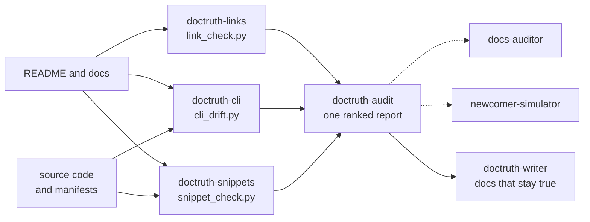

# docs-truth-skill

**Your README is a claim. Check it.**


The quick start says `--workers 4`, and the flag was renamed to `--jobs` two releases ago. The
install line pins a version that no longer exists. A link points at a file somebody moved, a
Python snippet still uses `print "x"`, and an environment variable in the table is not read by
anything. Each one is a first-run failure for a new user, and none of them fails your tests.

This Claude Code pack finds that drift. Three helper scripts read your docs and your code
statically and report where they disagree. Five skills turn the reports into small fixes, one
prioritised audit, and a procedure for writing docs that stay true. Nothing in a document is ever
executed, and the network is never touched unless you pass `--online`.

Everything runs locally with the Python standard library. The output is deterministic.

## What's inside

| Skill | What it does |
|---|---|
| [`doctruth-links`](skills/doctruth-links/SKILL.md) | `link_check.py`: broken relative links, wrong letter case, missing images, anchors that do not exist (GitHub slug rules), empty and TODO links, http and localhost links, orphaned docs. Opt-in `--online` check for external URLs. |
| [`doctruth-cli`](skills/doctruth-cli/SKILL.md) | `cli_drift.py`: flags, subcommands and environment variables in the docs versus argparse, click, typer, Go flag and cobra, commander and env reads in the code. Probable renames, wrong defaults, a generated options table. |
| [`doctruth-snippets`](skills/doctruth-snippets/SKILL.md) | `snippet_check.py`: Python, JSON, YAML, TOML, JS/TS and shell fences checked without running them, imports of your own package, stale versions in install commands, missing files in commands, stale function names. |
| [`doctruth-audit`](skills/doctruth-audit/SKILL.md) | Runs the three scripts, merges the findings, ranks broken first-run instructions highest, and proposes a minimal patch per finding. Calls the scripts in the three sibling skill folders. |
| [`doctruth-writer`](skills/doctruth-writer/SKILL.md) | A procedure for docs that stay true: derive tables from code, checkable snippets, a quick start under five steps, a docs check in CI, a "verified on" line. |

| Agent | What it does |
|---|---|
| [`docs-auditor`](agents/docs-auditor.md) | Takes the checkers' findings, confirms each by reading the code, and rejects false positives with the reason. |
| [`newcomer-simulator`](agents/newcomer-simulator.md) | Walks your quick start as a first-time user, by reading only, and reports the first step where they would get stuck. |

## Install

```
/plugin marketplace add vivekbhange-hub/docs-truth-skill
/plugin install docs-truth-skill@docs-truth-skill
```

Manual install: copy `skills/*` into `~/.claude/skills/` and `agents/*` into `~/.claude/agents/`.
Keep the three script skills (`doctruth-links`, `doctruth-cli`, `doctruth-snippets`) together with
`doctruth-audit`, which calls their scripts by relative path.

Requirements: Python 3.9 or newer. Nothing else.

## Try it in 60 seconds

The repo ships a fictional project, [`examples/sample-project/`](examples/sample-project/): a small
Python CLI called taskpilot with a README and a `docs/` folder that have drifted on purpose. In
Claude Code:

> Audit the docs in examples/sample-project

Or run the scripts yourself from the repo root (on Windows use `python` instead of `python3`):

```bash
python3 skills/doctruth-links/link_check.py examples/sample-project
python3 skills/doctruth-cli/cli_drift.py examples/sample-project
python3 skills/doctruth-cli/cli_drift.py examples/sample-project --table-only
python3 skills/doctruth-snippets/snippet_check.py examples/sample-project
```

Output copied from the committed files in [`examples/output/`](examples/output/).

**Links.** Four high findings, and the README's quick start is where most of them sit:

```text
Scanned 5 doc file(s) and 8 link(s) (7 local, 1 external). 9 finding(s): 4 high, 2 medium, 3 low, 0 info.
```

```text
| `README.md:55` | LK001 | high | Quick start (first run) | file not found: `docs/configuration.md` | did you mean `docs/config.md`? |
| `README.md:56` | LK002 | high | Quick start (first run) | letter case differs from the file on disk: `changelog.md` | use `CHANGELOG.md` |
| `README.md:56` | LK003 | high | Quick start (first run) | anchor `#custom-hooks` not found in `docs/usage.md` | check the heading text; GitHub drops punctuation |
| `docs/architecture.md:1` | LK009 | low |  | no other doc links to this file | link it from the README or an index page, or delete it if it is dead |
```

**CLI flags.** `--workers` has no counterpart in the code, so the script does not guess; `--out`
is close enough to `--output` to call a likely rename, and the environment variable table has
the same two problems:

```text
Documented: 8 flag(s), 4 command(s), 3 environment variable(s). Defined in code: 8 flag(s), 3 command(s), 3 environment variable(s).
```

```text
| `README.md:27` | CD001 | high | Quick start (first run) | `--workers` is documented but not defined | remove it from the docs, or add the flag to the code |
| `README.md:35` | CD007 | high | Quick start (first run) | `--out` is documented, the code defines `--output` (taskpilot/cli.py:24); likely renamed | update the docs to `--output` |
| `README.md:34` | CD009 | medium | Quick start (first run) | `--verbose` is documented under `status` but defined for `run` | move the example to `run --verbose` or add the flag to `status` |
| `docs/usage.md:8` | CD008 | medium | Options | `--timeout`: docs say default `30`, code says `60` (taskpilot/cli.py:15) | change the docs to `60` |
| `docs/config.md:8` | CD007 | medium | Environment variables | `TASKPILOT_TOKEN` is documented, the code reads `TASKPILOT_API_TOKEN` (taskpilot/core.py:18); likely renamed | update the docs to `TASKPILOT_API_TOKEN` |
```

`--table-only` prints the options table from the code, so the docs can be regenerated instead of
retyped:

```text
| Option | Command | Default | Env | Description |
| `--timeout` `VALUE` | `run` | `60` |  | seconds before a task is stopped |
| `--jobs`, `-j` `VALUE` | `run` | `4` |  | number of parallel jobs |
```

**Snippets.** The install command pins a version the project no longer has, the quick start copies
a file that does not exist, and two imports and a Python 2 `print` would fail for a reader. None of
the snippets was run:

```text
No snippet was executed; every check is static.
```

```text
| `README.md:11` | SN014 | high | Install (first run) | file `.env.sample` does not exist in the project | did you mean `.env.example`? |
| `README.md:42` | SN010 | high | Quick start (first run) | `load_all` is not defined in `taskpilot.core` | did you mean `load_tasks`? |
| `README.md:51` | SN001 | high | Quick start (first run) | Python syntax error near `print "starting"` | fix the snippet so it parses, or label it as pseudo-code (`text`) |
| `README.md:10` | SN012 | medium | Install (first run) | docs say 1.4.0, the declared version is 2.1.0 | use `2.1.0`, or stop pinning a version in the docs |
```

`python examples/regenerate.py --check` proves the committed outputs are exactly what the scripts
produce today, and the test suite checks that every quoted line above appears in them.

## How it works



1. **Read both sides statically.** The scripts parse Markdown (skipping code fences and inline
   code), Python with `ast`, and Go, JavaScript and TypeScript with patterns. They compare what
   the docs claim with what the code and the manifests say. Nothing is imported or executed.
2. **Rank by what a newcomer hits first.** Every finding carries its section and a `first_run` flag
   for Install, Quick start and Usage sections. `doctruth-audit` sorts first-run problems above
   everything else, then by severity.
3. **Fix with the smallest edit, then re-check.** Each skill ends with a patch for the cause it
   found and a re-run that shows the counts going down. `docs-auditor` confirms findings against
   the code and rejects false positives; `newcomer-simulator` reads the quick start as a first-time
   user would.
4. **Keep it true.** `doctruth-writer` generates tables from the code, keeps the quick start short,
   dates claims it cannot generate, and puts the checks in CI.

Exit codes for every script: `0` ok, `1` a finding at or above `--fail-on`, `2` bad input.
Every script has `--json` and `--fail-on high|medium|low|never` (default `never`).

## Responsible use

Run this on repositories you own or are authorized to work on.

- The scripts only read files. They never run a code block from a document, never import your
  package, and never run your CLI.
- `link_check.py --online` is off by default. When you turn it on it sends HEAD, then GET requests
  to the external URLs in your docs, at most `--max-requests` of them, with a delay between
  requests to one host. It never contacts private, loopback or link-local addresses, including
  after a redirect. Do not point it at links you are not allowed to probe.
- Findings describe documents, not people. Do not use them to rank or blame authors.
- Fixture data is fictional. Use placeholders for keys and tokens in any example you add.

## Principles and limits

- **The code is the source of truth.** The skills fix the docs to match the code, unless you say the
  code is the bug.
- **Static means partial.** Flags that the code builds dynamically are counted and listed, never
  guessed. Go, JavaScript and TypeScript are read with patterns, so unusual code can be missed.
  Python is parsed exactly.
- **Loose mentions are less certain than command lines.** A bare `--flag` in a sentence may belong
  to another tool such as `gh` or `curl`. Findings from command lines of your CLI rank high; findings
  from loose mentions rank medium. The script drops a flag written right after another tool's name.
- **Matching is by name, and flags are checked per command only for argparse and click.** Other
  frameworks are compared as one global set.
- **The function-name check is grep based.** It reports "possibly stale" only when nothing in the
  code mentions the name, and it skips names that look like library or built-in calls.
- **Snippet checks are syntax and reference checks.** A snippet can parse, import and still be
  wrong. YAML checks are basic. TOML needs Python 3.11 or newer (`tomllib`) and is skipped otherwise.
  Languages with no checker are counted, not judged.
- **Link slugs follow GitHub.** Other renderers (GitLab, MkDocs) slug headings differently, and
  anchors in reStructuredText and AsciiDoc files are not checked.
- **`--online` is a hint, not proof.** Sites that block bots answer 403 or 429, which is reported
  as unverified. A host's address is resolved before each request, so a hostile DNS answer between
  the check and the request is a residual risk.
- **Nothing leaves your machine.** No telemetry, no third-party packages.

## Contributing

See [CONTRIBUTING.md](CONTRIBUTING.md). Run the tests with
`python -m unittest discover -s tests -v`.

## Author

Built by [Vivek Bhange](https://vivekbhange.tech), Full-Stack AI Engineer.
See this project on my portfolio: https://vivekbhange.tech/projects/docs-truth-skill/
More open-source skill packs: https://vivekbhange.tech/projects/

## License

MIT (c) 2026 Vivek Bhange. See [LICENSE](LICENSE).
